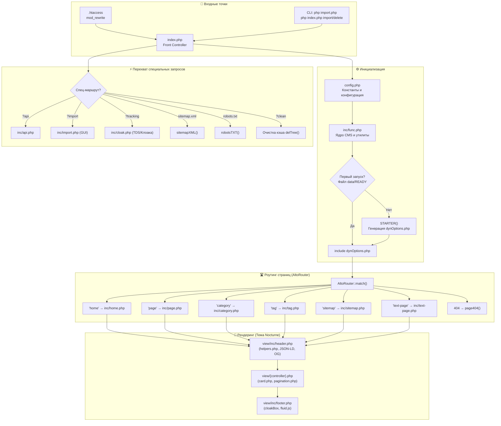
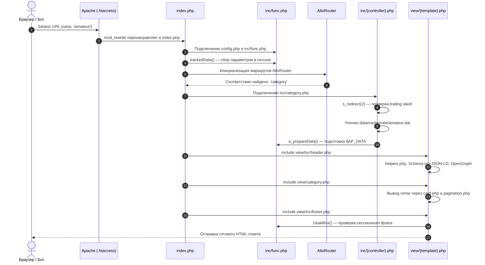
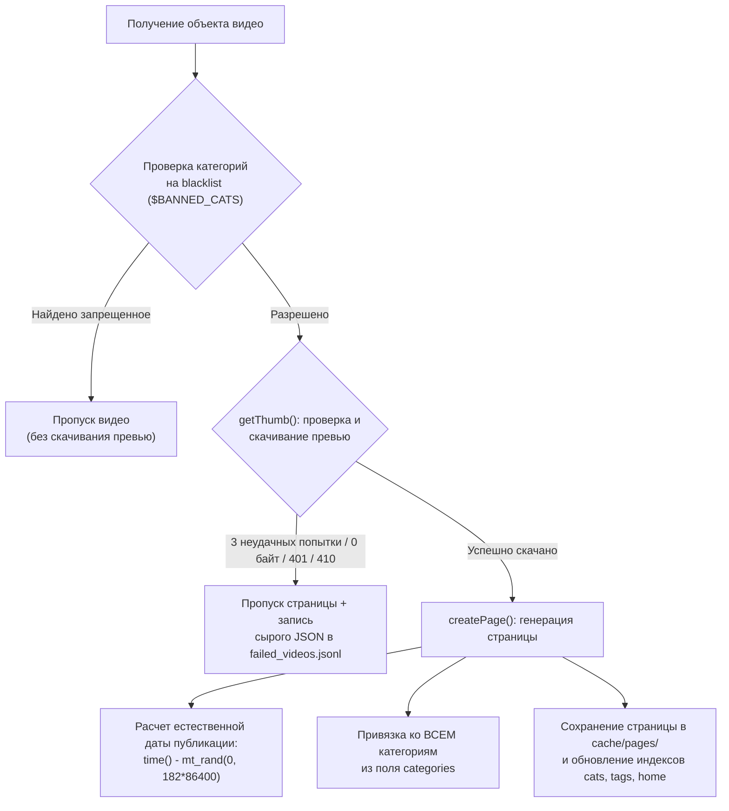

# 📚 TeaseAdultCMS v0.1z — Полная документация проекта

> **CMS для автоматической генерации контентных сайтов** на базе импортированного видео-контента с поддержкой SEO-оптимизации, spintax-шаблонов, клоакинга, трекинга, встроенного счётчика и современного адаптивного фронтенда (дизайн «Nocturne» / PornGalaxy).

---

## 📑 Содержание

1. [Общее описание](#общее-описание)
2. [Карта проекта (дерево файлов)](#карта-проекта)
3. [Архитектура системы](#архитектура-системы)
4. [Описание всех файлов](#описание-всех-файлов)
5. [Маршрутизация (Routing)](#маршрутизация)
6. [Жизненный цикл запроса](#жизненный-цикл-запроса)
7. [Система импорта контента](#система-импорта-контента)
8. [Система кэширования и хранения данных](#система-кэширования)
9. [SEO-система и микроразметка](#seo-система-и-микроразметка)
10. [Система клоакинга и трекинга](#система-клоакинга)
11. [Справочник функций ядра (func.php)](#справочник-функций-ядра)
12. [Справочник функций шаблона (helpers.php)](#справочник-функций-шаблона)
13. [Справочник классов](#справочник-классов)
14. [Конфигурация](#конфигурация)
15. [API](#api)
16. [Frontend (Тема «Nocturne»)](#frontend)
17. [История версий](#история-версий)

---

## Общее описание

**TeaseAdultCMS** — это файловая (flat-file) CMS, написанная на PHP, предназначенная для быстрого развёртывания и автономной работы контентных видео-сайтов. Проект не требует базы данных MySQL/PostgreSQL — все данные хранятся непосредственно в файловой системе (PHP-файлы страниц, `.dat`-файлы индексов, JSONL-логи, текстовые файлы).

### Ключевые особенности

| Возможность | Описание |
|---|---|
| **Flat-file хранение** | Полная независимость от СУБД — страницы компилируются в PHP-файлы с переменными |
| **Импорт контента** | Поддержка нового JSON API источников и классического CSV (HubTraffic). Доступен через Web GUI и консольный CLI |
| **Фильтрация и Blacklist** | Пропуск видео с запрещёнными категориями (`$BANNED_CATS`). Проверка превью (битые 0-байтные картинки отбрасываются и логируются в JSONL) |
| **Множественные категории** | Видео может принадлежать сразу нескольким категориям (разделитель `;`), автоматически привязываясь ко всем индексам |
| **Естественный разброс дат** | Автоматический сдвиг даты публикации импортированных видео назад во времени (до 6 месяцев) для естественной картины наполнения |
| **Spintax-движок** | Генерация сотен уникальных заголовков и описаний из шаблонов `{вариант1\|вариант2}` с поддержкой вложенности |
| **SEO и микроразметка** | Автоматические title, description, keywords, canonical, prev/next. Микроразметка Schema.org (`VideoObject`, `WebSite`, `BreadcrumbList`) и OpenGraph |
| **Sitemap** | Автоматическая генерация XML-карты `sitemap.xml` и интерактивной HTML-карты с вкладками категорий и тегов |
| **Клоакинг и TDS** | Встроенная система скрытых редиректов и разделения трафика для коммерческих переходов по метке `_RMARK_` |
| **Трекинг сессий** | Сбор входящих GET-параметров (UTM, subID) и сквозной проброс через сессию |
| **Встроенный счётчик** | Серверный сбор данных о посещениях (URI, IP, User-Agent, Referer) с выгрузкой через API |
| **Текстовые страницы (MVP)** | Встроенные юридические страницы (`/text/{slug}`) с автоматическим оглавлением (TOC) и формой контактов с защитой от спама (honeypot) |
| **Тема «Nocturne»** | Современный тёмный UI с космическим акцентом (PornGalaxy), чистым CSS, Vanilla JS, доступным drawer-меню и адаптивной пагинацией |

### Технический стек

- **Язык:** PHP 7.4+ (процедурный стиль, strict typing в новых модулях)
- **Сервер:** Apache + mod_rewrite (Open Server Panel)
- **Роутер:** [AltoRouter](https://github.com/dannyvankooten/AltoRouter)
- **HTTP-клиент:** cURL (одиночный с рандомизацией UA и таймаутами + параллельный multi_curl)
- **Обработка изображений:** GD Library (валидация размеров, ресайз и конвертация в JPEG)
- **Frontend:** Vanilla JavaScript (без внешних фреймворков), нативные CSS-переменные, SVG-иконки, FluidVids

---

## Карта проекта

```
adult.my/                          # 🏠 Корень проекта
│
├── .htaccess                      # ⚙️ Правила Apache: www→non-www, HTTP→HTTPS, front controller
├── index.php                      # 🚀 Точка входа — front controller и CLI-диспетчер
├── config.php                     # ⚙️ Конфигурация: пути, настройки, категории, стоп-слова
├── import.php                     # 💻 Автономный CLI-скрипт импорта видео
├── favicon.ico                    # 🖼️ Favicon сайта
├── ReadMe.txt                     # 📄 Краткая памятка по командам и тегам
├── changelog.txt                  # 📋 История версий и изменений проекта
├── DOCUMENTATION.md               # 📚 Данная полная документация
│
├── inc/                           # 📦 БИЗНЕС-ЛОГИКА (контроллеры и функции)
│   ├── func.php                   # 🔧 Главное ядро CMS (~1166 строк)
│   ├── home.php                   # 🏠 Контроллер главной страницы
│   ├── home-page.php              # 📄 Контроллер пагинации главной страницы
│   ├── page.php                   # 📄 Контроллер страницы видео
│   ├── category.php               # 📂 Контроллер категорий (+ роутинг списка тегов)
│   ├── tag.php                    # 🏷️ Контроллер страниц тегов
│   ├── sitemap.php                # 🗺️ Контроллер HTML-карты сайта
│   ├── text-page.php              # 📜 Контроллер текстовых (юридических) страниц
│   ├── import.php                 # 📥 Модуль Web-импорта контента (GUI)
│   ├── delete.php                 # 🗑️ CLI-скрипт проверки активности видео через API
│   ├── api.php                    # 🔌 Внутренний API (выгрузка и очистка данных счётчика)
│   ├── cloak.php                  # 🕶️ Модуль обработки клоакинга и редиректов
│   ├── loadFiles.php              # 📂 Вспомогательный модуль загрузки spintax/тегов
│   │
│   └── branch/                    # 📚 Сторонние библиотеки
│       ├── AltoRouter.php         # 🛣️ URL-маршрутизатор
│       ├── AngryCurl.class.php    # 🌐 Пакетный менеджер cURL-запросов
│       ├── RollingCurl.class.php  # 🌐 Параллельный асинхронный cURL
│       ├── gd_imagestyle.php      # 🖼️ Трансформации графики через GD
│       ├── parsers.php            # 🔍 Парсеры видеохостингов (4Tube, Fux, PornTube, RedTube, PornHub)
│       └── simple_html_dom.php    # 🔍 HTML DOM-парсер
│
├── data/                          # 💾 ДАННЫЕ, ШАБЛОНЫ И ИНДЕКСЫ
│   ├── STARTER.php                # 🎲 Базовые Spintax-шаблоны описаний (SEO)
│   ├── TAGLIST.txt                # 🏷️ Исходный список тегов
│   ├── TITLE-SPIN.txt             # 🎲 Spintax-шаблоны заголовков
│   ├── DESC-SPIN.txt              # 🎲 Spintax-шаблоны мета-описаний страниц
│   ├── MINI-DESC-SPIN.txt         # 🎲 Мини-описания для рейтинга
│   ├── subIDs.txt                 # 📋 База идентификаторов Sub ID
│   ├── UA.txt                     # 🤖 Актуальные User-Agent браузеров
│   ├── errIMGs.txt                # ⚠️ Лог ошибок загрузки картинок
│   ├── failed_videos.jsonl        # ⚠️ Лог видео с битыми превью (сырой JSON)
│   ├── dynOptions.php             # ⚙️ Авто-генерируемый кеш настроек (создаётся STARTER)
│   ├── READY                      # ✅ Маркер первичной инициализации сайта
│   ├── cloakBox.php               # 🕶️ Кастомный скрипт клоаки/попандера
│   ├── advert                     # 📢 Блок сквозной рекламы
│   ├── no_thumb.jpg               # 🖼️ Графическая заглушка отсутствующего превью
│   │
│   ├── SPINTAX/                   # 🎲 Дополнительные spintax-словари
│   │   ├── .htaccess              # 🔒 Запрет прямого веб-доступа
│   │   └── all-purpose.txt        # 🎲 Универсальный шаблон спинтакса
│   │
│   ├── adv/                       # 📢 Файлы рекламных зон
│   │   └── .htaccess              # 🔒 Защита директории
│   │
│   ├── text/                      # 📜 Исходные тексты юридических страниц
│   │   ├── .htaccess              # 🔒 Защита файлов
│   │   ├── privacy.html           # Политика конфиденциальности
│   │   ├── terms.html             # Условия обслуживания
│   │   ├── dmca.html              # Политика защиты авторских прав DMCA
│   │   └── contact.html           # Шаблон формы обратной связи
│   │
│   └── cache/                     # 💾 ОПЕРАТИВНЫЙ ФАЙЛОВЫЙ КЭШ
│       ├── .htaccess              # 🔒 Запрет скачивания .dat и .txt
│       ├── home.dat               # 🏠 Индекс слагов для главной страницы
│       ├── pages/                 # 📄 PHP-файлы скомпилированных страниц (*.php)
│       ├── cats/                  # 📂 Индексы категорий ({category}.dat)
│       ├── tags/                  # 🏷️ Индексы тегов ({tag}.dat)
│       ├── sitemap/               # 🗺️ Сериализованные страницы карты сайта
│       └── counter/               # 📊 Ежедневные логи счётчика (CN_{dmY}.dat)
│
├── static/                        # 🖼️ Локальные скачанные превью видео ({slug}.jpg)
│
└── view/                          # 🎨 ШАБЛОНЫ И РЕСУРСЫ (Тема «Nocturne»)
    ├── home.php                   # 🏠 Шаблон главной страницы (сетка видео)
    ├── home-page.php              # 📄 Алиас главной страницы
    ├── page.php                   # 📄 Шаблон страницы видео (плеер, мета, похожие)
    ├── category.php               # 📂 Шаблон страницы категории
    ├── tag.php                    # 🏷️ Шаблон страницы тега
    ├── sitemap.php                # 🗺️ Шаблон интерактивной HTML-карты сайта
    ├── text-page.php              # 📜 Шаблон текстовых страниц с оглавлением TOC
    ├── 404.php                    # ❌ Шаблон страницы ошибки 404
    │
    ├── inc/                       # 🧩 Компоненты шаблона
    │   ├── header.php             # 📋 Шапка: meta, JSON-LD, навигация, mega-menu, drawer
    │   ├── footer.php             # 📋 Подвал: навигация, fluidvids, cloakBox
    │   ├── helpers.php            # 🛠️ Библиотека функций темы «Nocturne»
    │   ├── card.php               # 🃏 Карточка видео (сетка)
    │   ├── mini-card.php          # 🃏 Компактная карточка видео (сайдбар)
    │   └── pagination.php         # 🔢 Адаптивная пагинация со стрелками и номерами
    │
    ├── assets/                    # 🎨 Активные стили и скрипты темы
    │   ├── css/
    │   │   ├── styles.css         # Базовые стили и адаптивная сетка
    │   │   ├── cosmos.css         # Космическая тема «PornGalaxy»
    │   │   └── cms.css            # Специфичные стили компонентов CMS
    │   ├── js/
    │   │   └── main.js            # Vanilla JS: меню, аккордеоны, валидация
    │   └── images/
    │       └── og-placeholder.svg # Векторная заглушка для OpenGraph
    │
    ├── images/                    # 🖼️ Графика темы (логотипы darklogo.png, лого)
    └── media/                     # 📁 Вспомогательные библиотеки (fluid.js)
```

---

## Архитектура системы



### Паттерн Front Controller

1. Любой HTTP-запрос перенаправляется сервером Apache на `index.php`.
2. `index.php` запускает сессию, регистрирует входящие параметры через `trackedData()`, проверяет системные флаги (`READY`, `dynOptions.php`) и выполняет роутинг.
3. Контроллер из `inc/` считывает скомпилированные PHP-файлы страниц или `.dat`-индексы, формирует массив `$AP_DATA` и переменные представления.
4. `index.php` поочередно подключает `view/inc/header.php`, основной шаблон страницы и `view/inc/footer.php`.

---

## Описание всех файлов

### Корневые файлы

| Файл | Назначение |
|---|---|
| [index.php](file:///d:/OSPanel/domains/adult.my/index.php) | **Главный входной контроллер.** CLI-диспетчер (`import`, `delete`), обработчик спец-маршрутов, инициализатор структуры каталогов, запуск роутера |
| [config.php](file:///d:/OSPanel/domains/adult.my/config.php) | **Конфигурация сайта.** Название сайта (`PornGalaxy`), пути к папкам, настройки клоаки, blacklist категорий (`$BANNED_CATS`), шаблоны SEO-заголовков |
| [import.php](file:///d:/OSPanel/domains/adult.my/import.php) | **Консольный скрипт импорта (CLI).** Автономный запуск импорта с аргументами URL, лимита и категорий, прогресс-баром и валидацией |
| [.htaccess](file:///d:/OSPanel/domains/adult.my/.htaccess) | **Директивы веб-сервера Apache.** Перенаправление с `www` на `non-www`, принудительный HTTPS, роутинг всех запросов на `index.php` |
| [DOCUMENTATION.md](file:///d:/OSPanel/domains/adult.my/DOCUMENTATION.md) | **Полная справочная документация** по архитектуре и коду CMS |

### Контроллеры (`inc/`)

| Файл | Назначение |
|---|---|
| [func.php](file:///d:/OSPanel/domains/adult.my/inc/func.php) | **Ядро системы.** Основная библиотека процедур: утилиты строк, загрузка картинок с валидацией, сборка страниц, генерация XML-карты, клоакинг |
| [home.php](file:///d:/OSPanel/domains/adult.my/inc/home.php) | Контроллер главной страницы: считывает `data/cache/home.dat`, разбивает на страницы по 20 штук через `archivePrepare()` |
| [home-page.php](file:///d:/OSPanel/domains/adult.my/inc/home-page.php) | Алиас для пагинации главной страницы (`/page/{id}`) |
| [page.php](file:///d:/OSPanel/domains/adult.my/inc/page.php) | Контроллер видео-страницы: загружает кэш страницы, собирает похожие видео (`$P_RELATED`), обрабатывает псевдостраницы (`_PSEUDO_`) |
| [category.php](file:///d:/OSPanel/domains/adult.my/inc/category.php) | Контроллер категорий (`/{cat}/{page}`): выборка видео из `data/cache/cats/{cat}.dat`. Также отдает общий список тегов по адресу `/tag/` |
| [tag.php](file:///d:/OSPanel/domains/adult.my/inc/tag.php) | Контроллер тегов (`/tag/{slug}/{page}`): выборка видео из `data/cache/tags/{slug}.dat` |
| [sitemap.php](file:///d:/OSPanel/domains/adult.my/inc/sitemap.php) | Контроллер HTML-карты сайта: постраничная выдача ссылок на видео |
| [text-page.php](file:///d:/OSPanel/domains/adult.my/inc/text-page.php) | Контроллер юридических страниц (`/text/{slug}`): чтение `data/text/{slug}.html`, обработка формы контактов с honeypot-ловушкой |
| [import.php](file:///d:/OSPanel/domains/adult.my/inc/import.php) | Модуль веб-импорта: интерфейс управления, парсинг JSON API / CSV, скачивание превью, фильтрация категорий |
| [cloak.php](file:///d:/OSPanel/domains/adult.my/inc/cloak.php) | Обработчик TDS/клоаки: взводит сессионный флаг `$_SESSION['tracked']`, осуществляет внешний или внутренний редирект |
| [api.php](file:///d:/OSPanel/domains/adult.my/inc/api.php) | API для удаленного снятия статистики счетчика (`?api=getcounter`) |
| [delete.php](file:///d:/OSPanel/domains/adult.my/inc/delete.php) | CLI-утилита для проверки активности видеороликов через API PornHub |

### Данные и шаблоны (`data/`)

| Файл/Папка | Назначение |
|---|---|
| `data/cache/pages/` | Скомпилированные PHP-файлы видео. Каждый файл содержит переменные `$P_TITLE`, `$P_EMBED`, `$P_THUMB`, `$P_CATS` и др. |
| `data/cache/cats/` | Файлы индексов категорий `{category}.dat` — содержат списки слагов видео по одному на строку |
| `data/cache/tags/` | Файлы индексов тегов `{tag}.dat` |
| `data/cache/home.dat` | Главный индекс сайта — упорядоченный список слагов всех опубликованных видеороликов |
| `data/failed_videos.jsonl` | Лог непрошедших импорт видео (битые/недоступные превью) в сыром JSON-формате для последующего анализа |
| `data/text/` | HTML-шаблоны юридических документов: `privacy.html`, `terms.html`, `dmca.html`, `contact.html` |
| `data/cloakBox.php` | Файл кастомного скрипта клоакинга (попандер/редирект), подключаемый один раз для целевых пользователей |
| `data/STARTER.php` | Spintax-шаблоны для генерации SEO-описаний главной, категорий, тегов, 404 и sitemap |

---

## Маршрутизация

### Специальные маршруты (`index.php`)

Обрабатываются в начале `index.php` до запуска основного роутера:

| Запрос / Команда | Условие проверки | Выполняемое действие |
|---|---|---|
| `php import.php [url] [limit] [cat]` | Консольный запуск | Автономный CLI-импорт контента |
| `php index.php import [url] ...` | `$argv[1] == 'import'` | CLI-импорт через index.php |
| `php index.php delete` | `$argv[1] == 'delete'` | Запуск скрипта `inc/delete.php` |
| `/?api=getcounter` | `stripos(URI, '?api') == '1'` | Выгрузка логов счётчика (`inc/api.php`) |
| `/?tracking=...` | `isset($_GET[_RMARK_])` | Перехват клоаки / TDS (`inc/cloak.php`) |
| `/?import` | `stripos(URI, '?import') == '1'` | Веб-интерфейс импорта (`inc/import.php`) |
| `/sitemap.xml` | `preg_match('~/sitemap\.xml~')` | Генерация и вывод XML-карты `sitemapXML()` |
| `/robots.txt` | `preg_match('~/robots\.txt~')` | Генерация текстового `robots.txt` |
| `/?clean` | `isset($_GET['clean'])` | Очистка кэша `data/cache/` и картинок `static/` |

### Таблица маршрутов AltoRouter

| HTTP Метод | Паттерн маршрута | Имя | Контроллер (`inc/`) | Шаблон (`view/`) | Пример URL |
|---|---|---|---|---|---|
| `GET` | `/` | `home` | `home.php` | `home.php` | `https://adult.my/` |
| `GET` | `/page/[i:id]/?` | `home-page` | `home-page.php` | `home.php` | `https://adult.my/page/2` |
| `GET` | `/sitemap/[i:id]/?` | `sitemap` | `sitemap.php` | `sitemap.php` | `https://adult.my/sitemap/1` |
| `GET` | `/[:id].html` | `page` | `page.php` | `page.php` | `https://adult.my/hot-milf-creampie.html` |
| `GET` | `/[:id]/[i:pg]?/?` | `category` | `category.php` | `category.php` | `https://adult.my/amateur/` |
| `GET\|POST` | `/text/[:id]?` | `text-page` | `text-page.php` | `text-page.php` | `https://adult.my/text/privacy` |
| `GET` | `/tag/[*:id]?/[i:pg]?/?` | `tag` | `tag.php` | `tag.php` | `https://adult.my/tag/big-tits/` |

---

## Жизненный цикл запроса



---

## Система импорта контента

Система импорта поддерживает два независимых интерфейса: **Web GUI** (`/?import`) и **Консольный CLI** (`import.php`).

### 1. Форматы источников данных

#### А. JSON API (Основной источник)
Эндпоинт вида `http://92.115.179.18/index.php?n=50`:
```json
{
  "count": 10,
  "items": [
    {
      "id": 2808997,
      "frame": "<iframe src=\"https://www.pornhub.com/embed/683ffb6c5b7a0\" ...></iframe>",
      "orig_img": "https://ei.phncdn.com/videos/.../original/0.jpg",
      "title": "spooky milk Life Game Porn Gallery Collection",
      "tags": "cum-compilation;big-boobs;hot-milf",
      "categories": "Big Ass;Big Tits;Creampie;MILF",
      "time": 330
    }
  ]
}
```

#### Б. CSV / HubTraffic (Резервный источник)
Разделитель строк — `|`:
```
embed_code|title|tags|duration|thumbnail_url|flipbook_frames
```

### 2. Алгоритм фильтрации и валидации



### 3. Запуск импорта через CLI

Команда выполняется в терминале:
```bash
# Использование автономного скрипта
php import.php [url] [limit] [category]

# Либо через точку входа
php index.php import [url] [limit] [category]
```

**Параметры:**
* `url` *(опционально)*: URL JSON API или CSV источника (по умолчанию: `http://92.115.179.18/index.php?n=50`).
* `limit` *(опционально)*: Максимальное количество видео для импорта (по умолчанию: `50`).
* `category` *(опционально)*: Принудительное назначение категории (по умолчанию: `auto` — берутся категории из источника).

**Пример вывода:**
```
=========================================
   TeaseAdultCMS — CLI Video Importer   
=========================================
Источник:   http://92.115.179.18/index.php?n=50
Лимит:      50
Категория:  (Автоматически из источника)
-----------------------------------------
[+] [OK 1/50] ID:2808997 | spooky milk Life Game...
[x] [БИТОЕ ПРЕВЬЮ] ID:2684674 | Залогировано в data/failed_videos.jsonl
[-] [ПРОПУСК: BLACKLIST] ID:2406062 | Содержит запрещенную категорию
...
-----------------------------------------
ИТОГ РАБОТЫ:
  - Добавлено страниц:   42
  - Пропущено/Ошибок:    8
=========================================
```

---

## Система кэширования

База данных проекта представляет собой файловый кэш в директории `data/cache/`:

| Директория / Файл | Структура | Описание |
|---|---|---|
| `cache/home.dat` | Текст (построчно) | Список слагов страниц видео в порядке добавления |
| `cache/pages/{slug}.php` | Исполняемый PHP | Файл страницы со свойствами `$P_TITLE`, `$P_DESC`, `$P_EMBED`, `$P_THUMB`, `$P_CATS`, `$P_CREATE` |
| `cache/cats/{cat}.dat` | Текст (построчно) | Индекс видео конкретной категории. Одно видео может присутствовать сразу в нескольких файлах |
| `cache/tags/{tag}.dat` | Текст (построчно) | Индекс видео по тегу |
| `cache/sitemap/stmpg-{n}.dat` | Сериализованный массив | Кэш страниц карты сайта с заголовками и датами для быстрой отдачи |
| `cache/counter/CN_{dmY}.dat` | Текстовый лог | Записи визитов вида `timestamp##$##URI##$##Referer##$##UA##$##IP` |

---

## SEO-система и микроразметка

### 1. Мета-теги и заголовки

* **Title**: Формируется функцией `r_title()` на базе шаблонов `$TITLE_TPL` из `config.php` с подстановкой макросов:
  * `#KWD#` — ключевое слово / название видео
  * `#DLM#` — разделитель из `dynOptions.php`
  * `#SNM#` — название сайта (`$SITE_NAME`)
  * `#ST#` — спарсенный или сгенерированный подзаголовок
* **Description**: Генерируется spintax-модулем на базе шаблонов `STARTER.php` (`$CAT_DESC`, `$TAG_DESC`, `$MAIN_DESC`).
* **Canonical и Prev/Next**: Выводятся функцией `indexOpt()` в `<head>` для исключения дублей страниц при пагинации.

### 2. Структурированные данные Schema.org (JSON-LD)

В шапке `view/inc/header.php` и шаблонах динамически генерируется семантическая разметка:

1. **`VideoObject` (на странице видео)**:
   ```json
   {
     "@context": "https://schema.org",
     "@type": "VideoObject",
     "name": "Название видео",
     "description": "Описание видео",
     "thumbnailUrl": "https://adult.my/static/slug.jpg",
     "uploadDate": "2026-05-14T10:15:00+03:00",
     "duration": "PT5M30S",
     "embedUrl": "https://adult.my/slug.html",
     "inLanguage": "en",
     "isFamilyFriendly": false
   }
   ```
2. **`WebSite` (на главной странице)**:
   Разметка поискового представления сайта с локалью и именем бренда.
3. **`BreadcrumbList` (Хлебные крошки)**:
   Генерируется хелпером `v_breadcrumbs_jsonld()` на страницах категорий, тегов, видео, карты сайта и юридических страниц.
4. **OpenGraph и Twitter Cards**:
   Мета-теги `og:title`, `og:description`, `og:image` (с поддержкой fallback на векторный `og-placeholder.svg`), `twitter:card: summary_large_image`.

---

## Система клоакинга

Клоака предназначена для монетизации коммерческого трафика (переходы со спама, дорвеев, кликандеров) без ущерба для поисковой индексации.

```mermaid
flowchart TD
    REQ["Запрос посетителя"] --> CHK{"Содержит GET-параметр<br/>_RMARK_ (?tracking=...)"}
    CHK -->|Нет (поисковый бот / прямой переход)| NORM["Обычная отдача сайта (чистый HTML)"]
    CHK -->|Да (целевой коммерческий трафик)| TRK["trackedData(): сохранение параметров в сессию"]
    TRK --> CLK["inc/cloak.php"]
    CLK --> SET["$_SESSION['tracked'] = true<br/>$_SESSION['sub_iddqd'] = subid"]
    
    SET --> MODE{"Схема работы клоаки"}
    MODE -->|Прямой редирект| REDIR["302 Редирект на оффер (_R_URL_)"]
    MODE -->|Сплит-прокладка| LOCAL["Внутренний редирект на случайное<br/>видео сайта (_RNREDIR_)"]
    
    LOCAL --> PAGE["Загрузка страницы видео"]
    PAGE --> FOOT["view/inc/footer.php: cloakBox()"]
    FOOT --> TRG{"$_SESSION['tracked'] == true?"}
    TRG -->|Да| FIRE["$_SESSION['tracked'] = false<br/>Подключение data/cloakBox.php<br/>(однократный попандер / JS)"]
    TRG -->|Нет| PASS["Обычный подвал"]
```

### Механика работы по шагам:

1. **Входная точка:** Запрос с меткой `?tracking=12345` перехватывается в `index.php:36`.
2. **Фиксация состояния:** В `inc/cloak.php` взводится флаг `$_SESSION['tracked'] = true`, а значение параметра запоминается в `$_SESSION['sub_iddqd']`.
3. **Подстановка параметров:** В целевой URL оффера (`_R_URL_`) подставляются макросы `##C_PAGE##` (текущая страница) и `##SUB##` (значение subID).
4. **Однократное срабатывание (One-Time Execution):** В подвале страницы вызывается `cloakBox()`. Если флаг `$_SESSION['tracked']` равен `true`, он **сразу сбрасывается в `false`**, и выполняется подключение `data/cloakBox.php`. Поисковые системы и обычные серферы скрипт никогда не получают.

---

## Справочник функций ядра

Все системные функции объявлены в файле [`inc/func.php`](file:///d:/OSPanel/domains/adult.my/inc/func.php):

### Обработка данных и строк
* `cleanStr($str, $st)` — очистка строки от табуляций, переводов строк и лишних пробелов; `$st=1` применяет `strip_tags()`.
* `cleanArray($a, $m)` — удаление пустых элементов из массива.
* `str2id($s)` — преобразование произвольной строки в валидный URL-слаг.
* `normalizeCatSlug($s)` — строгая нормализация категории к слагу (lowercase, замена спецсимволов на дефис, схлопывание повторов).
* `isBannedCats($cats, $banned)` — проверка наличия запрещенных категорий из массива `$banned` (`$BANNED_CATS`).
* `mb_ucwords($str)` — перевод первого символа каждого слова в верхний регистр с поддержкой UTF-8.
* `filterBW($s)` — удаление стоп-слов из строки по списку `$BAD_WORDS`.

### Изображения и превью
* `getThumb($url, $uri)` — скачивание превью с 3 попытками повтора, проверка валидности (размер > 500 байт, корректный MIME), ресайз через GD и сохранение в `static/{uri}.jpg`. При неудаче возвращает `false` (без создания битых файлов).
* `p_thumb($thumb)` — вывод полного URL к файлу превью (поддерживает как локальные файлы, так и внешние ссылки).
* `p_thumb_url($thumb)` — возвращает URL превью строкой для использования в атрибутах, JSON-LD и OG-тегов; при отсутствии возвращает fallback `data/no_thumb.jpg`.
* `conv2JPEG($orig, $out, $mime, $q)` — конвертация PNG, GIF, BMP и WebP в формат JPEG средствами GD.

### Страницы и контент
* `createPage($data, $URI, $incat)` — создание PHP-файла страницы в кэше, расчет сдвинутой даты публикации (`$PG['create']`), регистрация во всех категориях, тегах и карте сайта.
* `p_categories()` — вывод кликабельного списка категорий видео через запятую.
* `p_tags()` — вывод HTML-ссылок на теги текущего видео.
* `p_timeago($ts)` — человекопонятный расчет прошедшего времени с момента публикации («3 days ago», «2 months ago»).
* `p_views($time, $title)` — детерминированный алгоритмический псевдо-счетчик просмотров видео на основе CRC32 заголовка и даты.
* `p_relatedPages()` — выборка связанных видеороликов из кэша для блока похожих записей.

### Сеть и роутинг
* `getCurl($lnk, $cookie, $ref)` — надежный cURL-запрос с автоматической ротацией User-Agent из `data/UA.txt`, таймаутами соединения (15с/30с) и обходом SSL-ошибок.
* `s_redirect($t)` — принудительный 301-редирект для нормализации URL: `$t=1` удаляет завершающий слэш, `$t=2` добавляет его.
* `page404()` — отправка HTTP-заголовка 404 Not Found и подключение шаблона страницы ошибки.
* `sitemapXML()` — генерация валидного XML-документа карты сайта `sitemap.xml` с директивами `<loc>` и `<lastmod>`.
* `robotsTXT()` — генерация директив поисковой индексации `robots.txt`.

---

## Справочник функций шаблона

Функции визуального представления темы «Nocturne» объявлены в [`view/inc/helpers.php`](file:///d:/OSPanel/domains/adult.my/view/inc/helpers.php):

| Функция | Назначение |
|---|---|
| `v_esc($s)` | Безопасное экранирование строк для вывода в HTML-атрибуты и текст (`ENT_QUOTES`, UTF-8) |
| `v_num($n)` | Компактное форматирование больших чисел просмотров: `1.2M`, `348K`, `1,240` |
| `v_views($time, $title)` | Обёртка вызова счетчика просмотров CMS с форматированием через `v_num()` |
| `v_date($ts)` | Форматирование даты публикации в читаемый вид (напр. `Oct 25, 2026`) |
| `v_iso($ts)` | Форматирование временной метки в стандарт ISO 8601 для тегов `<time datetime="...">` |
| `v_page_url($n)` | Генерация корректного URL для n-ой страницы пагинации с учетом текущего роута (home, category, tag, sitemap) |
| `v_cats_all()` | Получение массива всех доступных категорий сайта для мега-меню и мобильного аккордеона |
| `v_tags_all($limit)` | Получение списка всех тегов сайта из папки `data/cache/tags/` с опциональным лимитом |
| `v_text_pages()` | Возвращает список зарегистрированных юридических страниц (`slug => Title`) |
| `v_total_videos()` | Подсчет общего количества уникальных видеороликов в каталоге по записям `home.dat` |
| `v_doc_toc($html)` | Автоматический парсер текста юридической страницы: находит `<h2>`/`<h3>`, генерирует ID-якоря и возвращает оглавление (TOC) |
| `v_tag_chips()` | Вывод тегов видео в виде стилизованных ссылок-бейджей `.tag` |
| `v_cat_chips()` | Вывод категорий видео в виде стилизованных ссылок-бейджей `.tag` |
| `v_cats_list()` | Получение структурированного массива категорий текущего видео для хлебных крошек |
| `v_breadcrumbs_jsonld($items)` | Генерация Schema.org микроразметки `BreadcrumbList` в формате JSON-LD |

---

## Справочник классов

### Класс `Spintax`
Файл: [`inc/func.php`](file:///d:/OSPanel/domains/adult.my/inc/func.php)
Рекурсивный парсер спинтакса. Раскрывает конструкции вида `{вариант 1|вариант 2|{вложенный 1|вложенный 2}}`:
* `Spintax::process($text)` — выполняет поиск и замену конструкций через регулярные выражения до полного раскрытия шаблона.
* `Spintax::replace($text)` — внутренний callback, случайным образом выбирающий один элемент из переданного списка через `array_rand`.

### Классы парсеров (`inc/branch/parsers.php`)
Набор классов для извлечения метаданных и генерации embed-плееров с внешних сайтов:
* `P_vidPrnhb` — парсер PornHub.
* `P_vidRdtb` — парсер RedTube.
* `P_vidPrntb` — парсер PornTube.
* `P_vid4tb` — парсер 4Tube.
* `P_vidFxcm` — парсер Fux.

---

## Конфигурация

Все ключевые константы и параметры задаются в [`config.php`](file:///d:/OSPanel/domains/adult.my/config.php):

```php
# Основные параметры сайта
$SITE_NAME = 'PornGalaxy';       // Название бренда сайта
define('_EXT_', '.html');        // Расширение URL контентных страниц (.html, .php)
define('_DEBUG_', true);         // Режим отладки (включает доступ к import, clean, delete)
define('_PROTO_', 'http:');      // Протокол сайта (http: или https:)
define('_SITEMAPLINKS_', 100);   // Количество ссылок на страницу в sitemap

# Клоакинг и трекинг
define('_RMARK_', 'tracking');   // GET-маркер перехвата клоаки (?tracking)
define('_RNREDIR_', 1);          // Редирект на случайную внутреннюю страницу при клоаке
define('_R_URL_', 'https://syndication.exosrv.com/splash.php?...&p=##C_PAGE##&sub=##SUB##');

# Фильтрация и модерация
$BANNED_CATS = ['gay', 'trans', 'ladyboy', 'shemale', 'men', 'muscular-men']; // Blacklist категорий
$DEFCAT_LIST = ['amateur', 'asian', 'babe', 'blonde', 'college', 'ebony', 'lesbian', 'milf', 'teen']; // Базовые категории
$DEF_TAGS    = ['porno tube', 'porno video', 'sex', 'hardcore', 'hot', 'hd porn', 'exclusive']; // SEO-теги по умолчанию

# Spintax и псевдостраницы
define('_PSEUDO_', 0);           // Включение промежуточных страниц перед просмотром
define('_SPIN_', 'all-purpose.txt'); // Словарь спинтакса
```

---

## API

### Получение и удаление данных встроенного счётчика

CMS содержит встроенный легковесный серверный счётчик визитов (активируется константой `_CNT_ = 1`).

* **Получение логов:**
  ```http
  GET /?api=getcounter
  ```
  Возвращает текстовые данные визитов за прошедшие дни (сегодняшний день исключается, чтобы не нарушать активную запись).
  Формат строк:
  ```
  1761912400##$##/hot-video.html##$##https://google.com/##$##Mozilla/5.0...##$##192.168.1.50
  ```

* **Получение с очисткой архива:**
  ```http
  GET /?api=getcounter&delete
  ```
  Считывает все накопленные данные и безвозвратно удаляет архивные файлы из папки `data/cache/counter/`.

---

## Frontend (Тема «Nocturne»)

Тема оформления **«Nocturne»** (PornGalaxy) спроектирована по современным стандартам веб-доступности и максимальной производительности:

### 1. Архитектура стилей (`view/assets/css/`)
* **`styles.css`** — базовый каркас: CSS-переменные палитры, нормализация, типографика, кнопки и базовая сетка карточек.
* **`cosmos.css`** — тема «PornGalaxy»: глубокие темные фоновые градиенты, космические акценты, эффекты свечения карточек при наведении.
* **`cms.css`** — адаптивные компоненты CMS: стили видеоплеера, теги-бейджи, блок оглавления (TOC), оформление формы обратной связи и алертов.

### 2. Компоненты шаблона
* **Карточка видео (`view/inc/card.php`)**: Поддерживает отложенную загрузку `loading="lazy"` (для первых 4 карточек отключается для ускорения LCP), отображает бейдж длительности, название, количество просмотров и дату.
* **Адаптивная пагинация (`view/inc/pagination.php`)**: Автоматически скрывает лишние номера страниц на мобильных разрешениях (`<768px` и `<480px`), оставляя аккуратные стрелки и статус.
* **Мега-меню и Drawer (`view/inc/header.php`, `view/assets/js/main.js`)**: Полноэкранное мобильное меню с поддержкой ARIA-атрибутов (`aria-expanded`, `aria-hidden`) и закрытием по клавише `Esc`.

### 3. MVP Текстовых страниц
Страницы `/text/{slug}` (Privacy, Terms, DMCA, Contact):
* **Автоматическое оглавление (TOC):** Функция `v_doc_toc()` на лету считывает структуру заголовков `<h2>`/`<h3>`, генерирует якорные ссылки и блок навигации по странице.
* **Форма контактов («Обманка»):**
  * Скрытое honeypot-поле `website` для ловли спам-ботов.
  * Валидация заполнения имени, корректности e-mail и чекбокса согласия.
  * При успешной отправке отображается экран благодарности без реальной отправки писем через `mail()`.

---

## История версий

| Версия | Дата | Основные изменения |
|---|---|---|
| **v0.1z** | **25.10.2026** | **Исправление алгоритма публикации:** Случайный разброс даты создания видео (`createPage()`) назад во времени до полугода (`182*86400`) для естественного распределения постов. |
| **v0.1z** | **22.10.2026** | **Редизайн «Nocturne» и MVP текстовых страниц:** Полный переход на Vanilla JS и кастомный CSS (`styles.css`, `cosmos.css`, `cms.css`). Внедрение библиотеки `view/inc/helpers.php`. Добавлен контроллер `inc/text-page.php`, обработчик формы контактов с honeypot и оглавлением TOC. Разметка Schema.org (`VideoObject`, `BreadcrumbList`, `WebSite`). |
| **v0.1w** | **12.10.2026** | **Интеграция нового источника и CLI:** Поддержка JSON API (`http://92.115.179.18/index.php?n=X`). Консольный скрипт `import.php`. Валидация картинок превью (отсев битых 0-байтных файлов, логирование в `data/failed_videos.jsonl`). Мульти-категории (`$P_CATS`). Внедрен Blacklist категорий (`$BANNED_CATS`). |
| **v0.1b** | **02.11.2018** | Контроль дубликатов при импорте. Мелкие правки роутинга в `index.php`. |
| **v0.1b** | **30.09.2018** | Добавлена функция редиректа на случайную страницу (`_RNREDIR_`), проброс `subID` через метку `_RMARK_`. |
| **v0.1b** | **29.09.2018** | Внедрена система клоакинга: разделение трафика, вынос скрипта попандера в `data/cloakBox.php`. |
| **v0.1b** | **23.09.2018** | Ребрендинг в TeaseAdultCMS. Внедрение псевдостраниц с кадрами (`_PSEUDO_`), canonical-ссылки. |
| **v0.1a** | **08.10.2016** | Первая рабочая версия flat-file CMS. |
